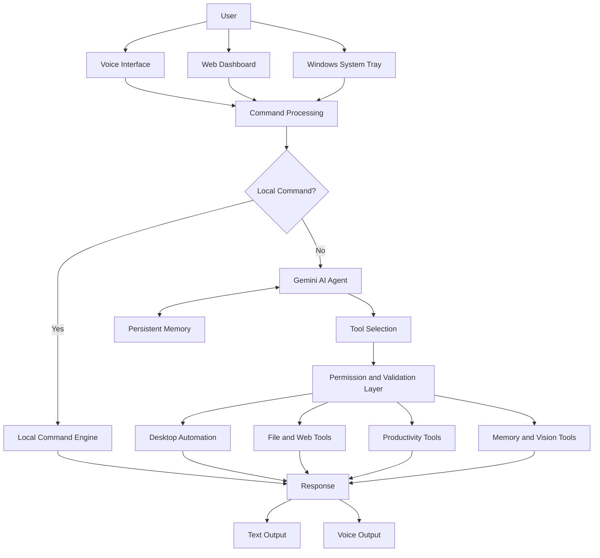
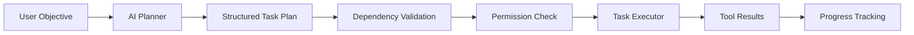
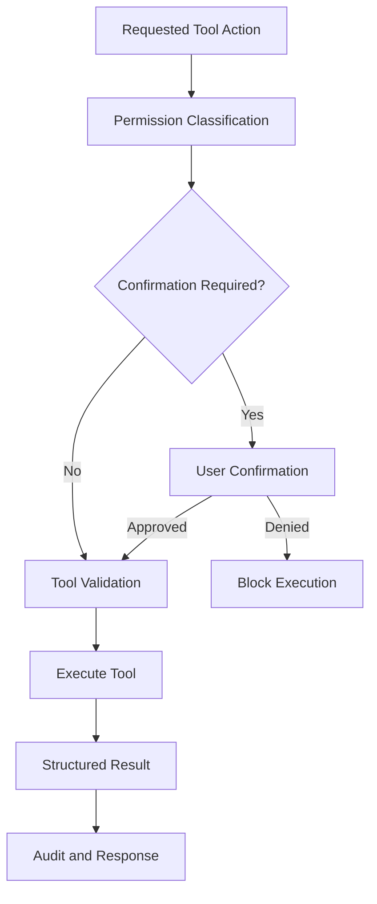

@'
<div align="center">

# ASTRA

### Advanced Smart Task and Reasoning Assistant

**An Agentic AI Desktop Assistant for Intelligent Automation, Productivity and Human–Computer Interaction**


*Think. Reason. Execute.*

</div>

---

## Overview

ASTRA is a Windows-based AI desktop assistant designed to bridge the gap between conversational artificial intelligence and real-world computer automation.

Unlike conventional chatbots, ASTRA is designed to interpret natural-language instructions, select appropriate tools, interact with desktop applications, manage information and assist users with everyday productivity tasks.

The project combines generative AI, agentic task planning, voice recognition, desktop automation, persistent memory, security controls and an interactive web dashboard within a modular Python architecture.

ASTRA is being developed as a practical exploration of AI agents, human-computer interaction and intelligent software automation.

---

## Key Features

### 1. Generative AI and Tool Execution

- Google Gemini integration
- Natural-language conversations
- Context-aware interactions
- Dynamic tool selection
- Function calling
- Multi-step task execution
- Structured tool responses
- Conversation history

### 2. Agentic AI Architecture

ASTRA 4.0 introduces a modular foundation for intelligent task planning and execution.

- AI-generated task plans
- Task decomposition
- Dependency-aware execution
- Tool registration and validation
- Permission-aware execution
- Task progress tracking
- Execution performance monitoring

The advanced planning and execution modules are currently undergoing integration and testing.

### 3. Voice Interaction

- Speech-to-text recognition
- Text-to-speech responses
- Configurable microphone selection
- Indian English recognition
- Adjustable microphone sensitivity
- Global keyboard shortcut
- Windows system tray interface
- Experimental offline wake-word detection using Vosk

Activate the voice assistant using:

`Ctrl + Alt + A`

Hands-free "Hey Astra" activation is currently under development.

### 4. Desktop Automation

ASTRA includes tools designed to perform desktop operations such as:

- Launching applications
- Opening websites
- Searching the web
- Browsing directories
- Reading text files
- Creating text files
- Safely deleting files
- Capturing screenshots
- Reading and updating clipboard contents
- Extracting PDF text
- Checking system information

Sensitive operations are designed to require user confirmation.

### 5. Local Command Engine

Common commands can be processed locally without requesting a response from Gemini.

Supported command implementations include:

| Command | Function |
|---|---|
| Open Google Chrome | Launch Chrome |
| Open Calculator | Launch Calculator |
| Open Notepad | Launch Notepad |
| Open VS Code | Launch Visual Studio Code |
| Open File Explorer | Launch File Explorer |
| What time is it? | Retrieve current time |
| Tell me the date | Retrieve current date |
| Battery status | Check battery percentage |
| Check CPU usage | Monitor CPU utilization |
| Check RAM usage | Monitor memory utilization |
| System status | Retrieve system information |

Local command execution is independent of Gemini quota.

Voice transcription currently requires an internet connection, and end-to-end tray integration is undergoing validation.

### 6. Personal Memory

- Persistent conversation history
- Personal information storage
- Memory retrieval
- Searchable memory records
- Category-based organization
- Memory deletion controls

Semantic memory and embedding-based retrieval are planned for future development.

### 7. Productivity and Academic Assistance

ASTRA includes productivity modules designed to assist with:

- Assignment management
- Examination planning
- Subject management
- Study scheduling
- Deadline tracking
- Focus timers
- Quiz analytics
- Performance tracking
- PDF-based learning assistance
- Revision and study material generation

### 8. Multimodal Vision

- Screenshot-based visual analysis
- AI-assisted screen understanding
- Contextual questions about screen contents
- User confirmation before screen capture and AI processing

### 9. Interactive Web Dashboard

The Flask-based dashboard provides interfaces for:

- AI conversations
- Voice interaction
- Personal memory
- Productivity management
- Academic planning
- Study analytics
- Vision assistance
- Automation
- System information
- Application settings

---

## System Architecture



### Experimental Agentic Planning Pipeline



The second diagram represents the ASTRA 4.0 planning modules currently under development.

---

## Technology Stack

| Technology | Purpose |
|---|---|
| Python | Core application development |
| Google Gemini | Generative AI and function calling |
| Google GenAI SDK | AI model integration |
| Flask | Web backend |
| HTML5 | Dashboard structure |
| CSS3 | Dashboard styling |
| JavaScript | Frontend interactions |
| SQLite | Persistent application data |
| SpeechRecognition | Speech-to-text |
| PyAudio | Microphone input |
| pyttsx3 | Text-to-speech |
| Vosk | Experimental offline wake-word recognition |
| PyAutoGUI | Desktop automation |
| Pystray | Windows system tray |
| Pillow | Image processing |
| PyPDF / PyPDF2 | PDF processing |
| psutil | System monitoring |
| python-dotenv | Environment configuration |
| Git and GitHub | Version control |

---

## Security Architecture

ASTRA incorporates security mechanisms intended to reduce the risks associated with AI-controlled desktop automation.

### Security Controls

- Permission-based tool execution
- Native Windows confirmation dialogs
- Restricted file-system access
- Protected file and directory validation
- File size limitations
- Path traversal protection
- Structured tool responses
- Security event logging
- Environment-based API key configuration
- Local application allowlists
- Safe file deletion mechanisms



These controls are under active development and should not be considered a complete security sandbox or independently audited security system.

---

## Project Structure

```text
ASTRA_AI_Personal_Assistant/
|
|-- core/
|   |-- app_config.py
|   |-- local_commands.py
|   |-- execution/
|   |   |-- agentic_service.py
|   |   |-- task_executor.py
|   |-- planning/
|   |   |-- ai_planner.py
|   |   |-- task_plan.py
|   |-- monitoring/
|   |   |-- performance.py
|   |-- providers/
|
|-- config/
|   |-- settings.py
|
|-- voice/
|   |-- stt.py
|   |-- tts.py
|   |-- wake_word.py
|
|-- tools/
|-- security/
|-- memory/
|-- student/
|-- frontend/
|-- services/
|   |-- rag/
|   |-- embeddings/
|   |-- memory/
|
|-- tests/
|-- utils/
|-- main.py
|-- agent.py
|-- tray_app.py
|-- web_app.py
|-- requirements.txt
|-- README.md
```

The structure includes both existing application modules and directories reserved for future development.

---

## Installation

### Prerequisites

- Windows 10 or Windows 11
- Python
- Git
- Google Gemini API key
- Working microphone for voice interaction

### 1. Clone the repository

```bash
git clone -b astra-v4 https://github.com/yashasviswami2/Astra-AI-Personal-Assistant.git
```

### 2. Open the project directory

```bash
cd Astra-AI-Personal-Assistant
```

### 3. Create a virtual environment

```powershell
python -m venv .venv
```

### 4. Install dependencies

```powershell
.\.venv\Scripts\python.exe -m pip install -r requirements.txt
```

### 5. Configure environment variables

Create a `.env` file in the project root.

```env
GEMINI_API_KEY=your_api_key_here
GEMINI_MODEL=your_available_gemini_model
```

Obtain an API key from:

https://aistudio.google.com/

Never commit your `.env` file or API credentials to GitHub.

### 6. Launch the desktop assistant

```powershell
.\.venv\Scripts\python.exe main.py
```

The ASTRA icon should appear in the Windows system tray.

### 7. Launch the web dashboard

```powershell
.\.venv\Scripts\python.exe web_app.py
```

Open:

http://127.0.0.1:5000

Dependency compatibility and clean installation are still being validated for ASTRA 4.0.

---

## Example Commands

```text
What time is it?

Open Google Chrome.

Check my battery status.

Open Calculator.

Check my system performance.

Explain dynamic programming.

Help me prepare for my examination.

Create a study schedule.

Summarize this PDF.

Analyze my screen.
```

Command availability depends on the installed modules, user permissions and AI service availability.

---

## Testing and Validation

The project includes testing and validation mechanisms for:

- File-system security
- Permission controls
- API endpoints
- Python module compilation
- Dependency compatibility
- Speech recognition
- Structured tool execution

Run the available automated tests:

```powershell
.\.venv\Scripts\python.exe -m unittest discover -s tests -v
```

Check dependency consistency:

```powershell
.\.venv\Scripts\python.exe -m pip check
```

ASTRA 4.0 is currently a development branch and has not completed full regression testing.

---

## Development Roadmap

### Existing Application Capabilities

- [x] Gemini AI integration
- [x] Speech recognition
- [x] Text-to-speech
- [x] Desktop automation tools
- [x] Windows system tray
- [x] Web dashboard
- [x] Persistent memory
- [x] Academic productivity modules
- [x] Multimodal vision tools
- [x] Security control implementations
- [x] Structured tool responses
- [x] Microphone calibration improvements

### ASTRA 4.0 Development

- [x] Modular architecture foundation
- [x] Agentic task planning modules
- [x] Dependency-aware task executor
- [x] Performance monitoring module
- [x] Local command engine implementation
- [x] Local application launcher implementation
- [x] Wake-word detection prototype
- [ ] Complete hands-free voice integration
- [ ] Automatic microphone selection
- [ ] Retrieval-Augmented Generation (RAG)
- [ ] Vector database integration
- [ ] Semantic long-term memory
- [ ] Multiple AI provider support
- [ ] Streaming AI responses
- [ ] Comprehensive automated testing
- [ ] Continuous integration pipeline
- [ ] Professional Windows installer
- [ ] Production-ready release

---

## Engineering Objectives

ASTRA is being developed to explore practical software engineering concepts including:

- Agentic artificial intelligence
- Large language model integration
- Function calling and tool orchestration
- Modular software architecture
- Human-computer interaction
- Natural-language processing
- Desktop automation
- Database management
- Secure AI execution
- Full-stack application development
- Software testing and version control

---

## Version History

| Version | Focus |
|---|---|
| ASTRA 1.0 | AI assistant foundation |
| ASTRA 2.0 | Voice interaction and desktop automation |
| ASTRA 3.0 | Productivity, memory, dashboard and security |
| ASTRA 4.0 | Agentic architecture and advanced AI capabilities |

Current development branch: `astra-v4`

Previous project branch: `astra-v1`

---

## Known Limitations

- Gemini-powered responses depend on API availability and quota.
- Voice transcription currently uses an online recognition service.
- Local application launching depends on Windows installation paths.
- Wake-word recognition is experimental.
- Advanced agentic planning is undergoing integration.
- RAG and semantic memory are not yet complete.
- Security mechanisms require further testing.
- ASTRA 4.0 is not yet a production-ready release.

---

## Developer

### Yashasvi Swami

Computer Science and Engineering

Interested in Artificial Intelligence, Agentic AI, Software Engineering, Intelligent Automation and Full-Stack Development.

[](https://github.com/yashasviswami2)

[](https://github.com/yashasviswami2/yashasvi-portfolio)

---

<div align="center">

### ASTRA

**Think intelligently. Act responsibly. Automate efficiently.**

If you find this project interesting, consider giving the repository a star.

Built with Python, Artificial Intelligence and curiosity.

</div>
'@ | Set-Content -Path README.md -Encoding utf8
