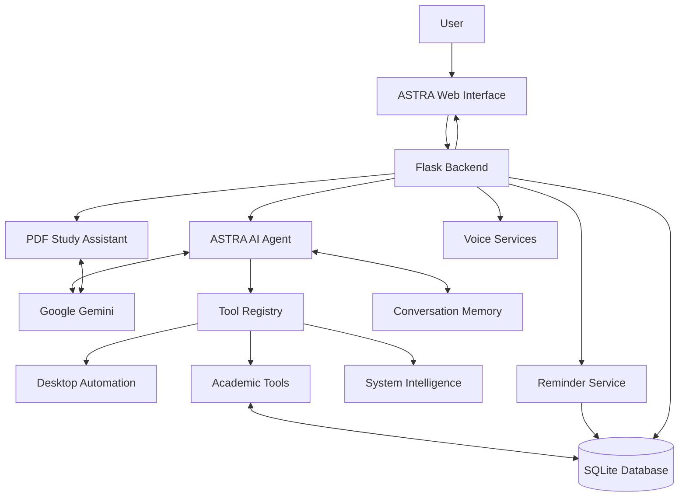

# ASTRA 2.0

### Advanced Smart Task and Reasoning Assistant

An Intelligent Agentic AI Desktop Assistant for Academic
Productivity and Personal Automation.


## Overview

ASTRA is an intelligent AI-powered desktop assistant designed
to improve academic productivity and simplify everyday
computer tasks.

Unlike conventional chatbots, ASTRA combines conversational
artificial intelligence with tool execution, persistent
academic memory, document intelligence, voice interaction
and desktop automation.

## Key Features

### Agentic Artificial Intelligence

- Google Gemini integration
- 31 registered AI tools
- Natural language interaction
- Multi-step task execution
- Persistent conversation memory
- Context-aware responses

### Desktop Automation

- Application launching
- Web searching and browsing
- Screenshot capture
- File management
- Clipboard operations
- Date and time information

### Student Workspace

- Personalized student profile
- Semester and subject management
- Assignment tracking
- Assignment completion management
- Academic statistics
- Deadline prioritization

### Examination Planner

- Examination date management
- Persistent syllabus storage
- Examination countdown
- Personalized study planning
- Upcoming examination tracking

### AI Academic Tutor

- Subject-specific explanations
- Exam-oriented answers
- Programming assistance
- Quiz generation
- Revision notes
- Viva preparation

### PDF Study Material Assistant

- PDF summarization
- Concept explanation
- Examination notes
- Important practice questions
- MCQ generation
- Last-minute revision
- Document-based question answering

### Smart Academic Reminders

- Overdue assignment alerts
- Upcoming deadline notifications
- Examination reminders
- Automatic in-app reminder checks

### System Intelligence

- Live CPU monitoring
- RAM utilization
- Disk storage monitoring
- Battery information
- System uptime
- Resource usage recommendations

### Productivity Hub

- Pomodoro focus timer
- Short and long breaks
- Pause, resume and reset
- Completed focus session tracking

### Voice Assistant

- Speech-to-text
- Text-to-speech
- Microphone interaction
- Optional spoken AI responses

### Modern User Interface

- Dark-themed dashboard
- Markdown response rendering
- Programming code blocks
- Formatted tables
- Copy and download responses
- Conversation export

## Technology Stack

| Component | Technology |
|---|---|
| Programming Language | Python |
| Backend | Flask |
| Artificial Intelligence | Google Gemini |
| AI Architecture | Agentic Function Calling |
| Database | SQLite |
| Frontend | HTML, CSS, JavaScript |
| Speech Recognition | SpeechRecognition |
| Speech Synthesis | pyttsx3 |
| Desktop Automation | PyAutoGUI |
| PDF Processing | pypdf |
| System Monitoring | psutil |
| Markdown Rendering | Marked.js |
| HTML Sanitization | DOMPurify |
| Version Control | Git and GitHub |

## System Architecture



## Project Structure

```text
Personal_Assistant_Jarvis/
│
├── agent.py
├── main.py
├── web_app.py
├── tray_app.py
├── requirements.txt
├── README.md
├── .gitignore
│
├── config/
│   └── settings.py
│
├── frontend/
│   ├── index.html
│   ├── style.css
│   ├── script.js
│   └── vendor/
│
├── student/
│   ├── database.py
│   ├── pdf_assistant.py
│   └── reminders.py
│
├── tools/
│   ├── __init__.py
│   ├── app_launcher.py
│   ├── browser.py
│   ├── file_manager.py
│   ├── pdf_summarizer.py
│   ├── screenshot.py
│   ├── time_tools.py
│   ├── student_tools.py
│   ├── exam_tools.py
│   └── system_tools.py
│
├── memory/
│   └── conversation.py
│
├── voice/
├── utils/
└── data/
    └── astra.db
```

The local database is generated automatically and is not
included in the GitHub repository.

## Installation

### 1. Clone the repository

```bash
git clone -b astra-v1 https://github.com/yashasviswami2/Jarvis-AI-Personal-Assistant.git
cd Jarvis-AI-Personal-Assistant
```

### 2. Create a virtual environment

```powershell
python -m venv .venv
.\.venv\Scripts\Activate.ps1
```

### 3. Install dependencies

```powershell
python -m pip install -r requirements.txt
```

### 4. Configure the Gemini API key

Create a `.env` file in the project root.

```env
GEMINI_API_KEY=your_api_key_here
```

Obtain a Gemini API key from Google AI Studio.

Never share or commit your API key.

### 5. Run ASTRA

```powershell
python web_app.py
```

Open the following address in your browser:

http://127.0.0.1:5000

## Example Commands

- Open Google Chrome.
- Take a screenshot.
- Search the web for Python tutorials.
- Save my academic profile.
- Register my semester subjects.
- Remember my assignment deadline.
- Show my upcoming examinations.
- Teach me dynamic programming.
- Generate a personalized study timetable.
- Analyze my laptop performance.
- Tell me my battery percentage.

## Data Storage and Security

- Academic records are stored locally using SQLite.
- API credentials are excluded from version control.
- Personal conversation history is excluded from GitHub.
- AI responses are sanitized before HTML rendering.
- PDF documents are processed in memory.
- Extracted document text and AI queries are sent to
  Google Gemini for processing.

## Current Limitations

- Internet connectivity is required for Gemini responses.
- Gemini API usage limits may affect availability.
- Desktop automation is primarily designed for Windows.
- Scanned PDFs require additional OCR functionality.
- PDF analysis has document size and extraction limits.
- Automatic reminders require the web interface to be open.
- Active focus timers do not persist after a page reload.
- AI-generated information may contain inaccuracies.

## Future Scope

- Offline language model integration
- OCR-based document understanding
- Native Windows background notifications
- Mobile application integration
- Calendar synchronization
- Multi-user academic profiles
- Personalized learning analytics
- Advanced voice activation

## Project Objective

To design and develop an intelligent agentic AI assistant
that integrates academic productivity, natural language
interaction, persistent memory and desktop automation
within a unified software platform.

## Project Information

- Project Name: ASTRA
- Version: 2.0
- Domain: Artificial Intelligence
- Category: Agentic AI and Desktop Automation
- Platform: Windows
- Project Type: B.Tech Computer Science Academic Project